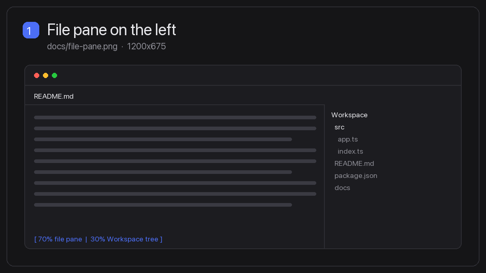
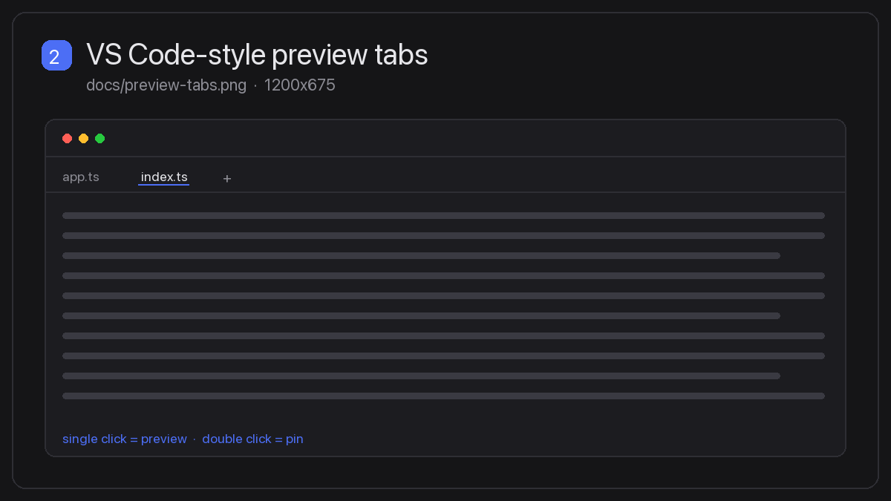
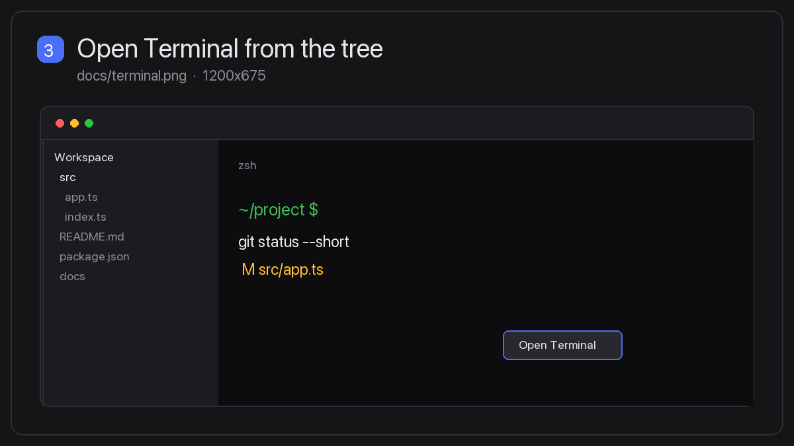
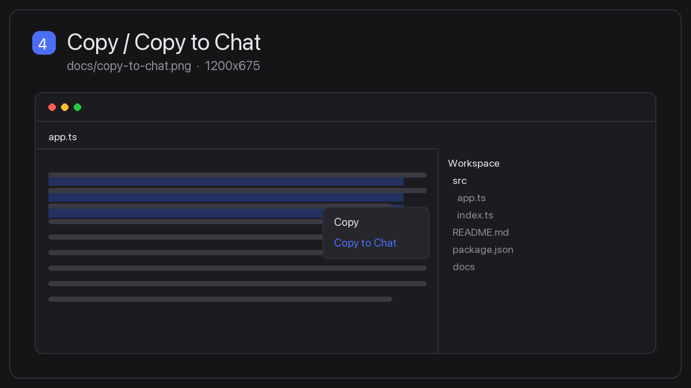

# dsh-file-pane

[](LICENSE)
[](https://github.com/deepseek-ai/deepseek-harness)

A VS Code-style file pane for the [DeepSeek Harness](https://github.com/deepseek-ai/deepseek-harness) (DSH) right sidebar: files open to the left of the Workspace tree, with preview tabs, an integrated terminal, and Copy to Chat.

English | [中文](README.zh.md)

## Screenshots

<!--
Replace these four files with your own 16:9 captures (1200x675 recommended).
Keep the filenames so the grid below keeps working.
-->

| 1. File pane on the left | 2. VS Code-style preview tabs |
| :---: | :---: |
| [](docs/file-pane.png) | [](docs/preview-tabs.png) |
| **3. Open Terminal from the tree** | **4. Copy / Copy to Chat** |
| [](docs/terminal.png) | [](docs/copy-to-chat.png) |

## Features

- **File pane on the left** — a file opened from the Workspace files tree lands in a pane to the *left* of the tree, so the tree stays visible on the right at a 70/30 split. If DSH cannot split or move the tab, it falls back to the stock behavior.
- **Preview tabs, VS Code-style** — a single click opens or replaces the one preview tab; a double click on a file (or on the tab) pins it. Preview tabs render in italics, and pinning is per session.
- **Open Terminal** — right-click a file, a folder, or empty space in the tree to open a terminal in that directory. The terminal opens as a sibling tab in the file pane, not over the tree.
- **Copy / Copy to Chat** — select text in the file preview and right-click. *Copy* keeps the native copy; *Copy to Chat* inserts a `@file #Lx-Ly` reference plus the selected code as a fenced block into the composer, without sending it.

## Install

Tested with DSH `0.2.1-rc.5`.

```sh
dsh plugin --profile desktop add github:sinvacn/dsh-file-pane
```

The install adds **dsh-file-pane** to your profile's `dsh.profile.bundles`; enable it in **Settings → Plugins** if it is off. The bundle's own patch registers the row, so no manual `cordis.patch.yml` edit is needed.

Refresh the page once. Hosts with profile HMR reload the entry automatically.

## Configuration

The default share for a new split is `0.7` (file/terminal pane on the left). Change it from the page console:

```js
localStorage.setItem('dsh.file-pane.share', '0.7')
```

Values are clamped to `0.2`–`0.8`. Existing splits keep their real ratio; drag a divider to adjust one.

## Compatibility and limitations

- Relies on internal sidebar controller (`adopted`), tab-store (`dropTab`, `resizeSplit`), and composer (`inputActions`) APIs. These are not public contracts, so re-test after DSH upgrades.
- The right sidebar's total width cap is unchanged, and existing splits are never rewritten automatically.
- If you keep the tree on the left yourself, files and terminals open in the right-hand sibling pane instead of swapping panes.
- Line ranges come from code and plain-text previews; previews without a line model (Markdown, PDF) insert the file reference and selected text without numbers.
- The terminal enters the target directory by sending `cd … && clear` after it becomes writable. The visible screen is clean, but the command stays in shell history and scrollback until DSH exposes a per-tab cwd.
- Copy to Chat only inserts into the composer; it never sends. Without a mounted composer, the payload is copied to the clipboard instead.

## Development

```sh
node test/run.mjs
```

10/10 tests pass, covering pane insertion, the default split, share clamping, preview replacement and pinning, non-file resources, missing tree panes, terminal paths, and disposal.

## License

[MIT](LICENSE)
