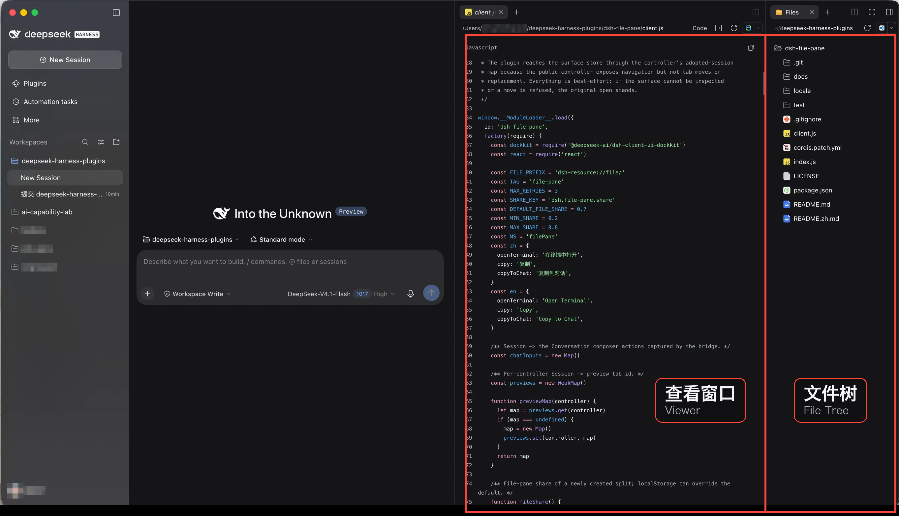
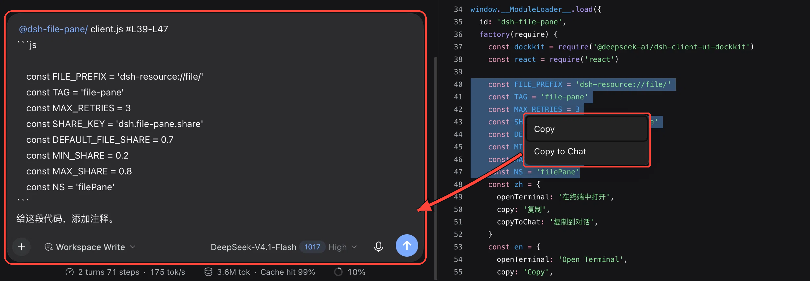

# dsh-file-pane

[English](README.md) | 中文

让 [DeepSeek Harness](https://github.com/deepseek-ai/deepseek-harness)（DSH）右栏的文件体验接近 VS Code、Codex：文件树常驻右侧，文件在左侧打开；单击预览、双击固定；右键开终端；选中代码一键 Copy to Chat。

## 截图

[](docs/layout-4-pane.png)

**4 栏布局。** 原右栏拆成两个：左边查看窗口，右边 Workspace 文件树。3 栏变 4 栏，代码和文件同屏。

[](docs/copy-to-chat.png)

**Copy to Chat。** 在文件预览里选中代码右键，`@文件 #Lx-Ly` 引用和选中代码会插入对话输入框，不会自动发送。

## 功能

1. **文件开在左侧**：点击 Workspace files 树里的文件，在树**左侧**的 pane 打开（默认 7:3）；树留在右边，展开状态和滚动位置保留。没空间 split 时回落到 DSH 原行为。
2. **Preview tab**：单击替换当前 preview，双击文件或 tab 固定；已经固定的 tab 单击只聚焦。
3. **右键 Terminal**：右键目录在该目录、右键文件在其所在目录打开终端，右键空白处在项目根目录打开；终端开在文件 pane 的兄弟 tab，不会盖住树。
4. **Copy / Copy to Chat**：在预览里选中文本右键，*Copy* 保持原复制行为，*Copy to Chat* 把 `@文件 #Lx-Ly` 引用和选中代码插入对话输入框，不自动发送。

插入内容示例：

````
@src/app.ts #L12-L14
```ts
export const b = 2
```
````

## 安装

测试于 DSH `0.2.1-rc.5`。

```sh
dsh plugin --profile desktop add github:sinvacn/dsh-file-pane
```

也可以直接在对话里让 agent 安装：

> 帮我安装 dsh-file-pane 插件：`dsh plugin --profile desktop add github:sinvacn/dsh-file-pane`

agent 会代你执行（需要终端权限，可能会请求批准）。两种方式都会把 **dsh-file-pane** 装进 profile 并自动注册侧栏 entry，不需要手动改配置；如果未启用，在 **Settings → Plugins** 里打开即可。

刷新 Harness 页面；如果侧栏没有更新，重启一次桌面 App。使用 Web profile 时把 `--profile desktop` 换成对应的 profile 名。

## 调整 pane 宽度

1. **手动拖 divider**：按 Session 记住比例。
2. 改新 split 的默认比例：

```js
localStorage.setItem('dsh.file-pane.share', '0.7') // 文件/终端 pane 占 70%
```

值夹在 `0.2`–`0.8`，默认 `0.7`。只影响之后新建的 split；已有 split 拖一次 divider 即可。

## 卸载

1. 在 **Settings → Plugins** 里关闭并移除 **dsh-file-pane**；
2. 或执行 `dsh plugin --profile desktop remove dsh-file-pane`；
3. 刷新页面或重启 App。

## 已知限制

- 右栏总宽度上限不变；默认 70/30，已有 split 不会被自动改写，拖 divider 可调整。
- 如果手动把树放在左边，文件/终端会开在右边的兄弟 pane，而不是交换 pane 顺序。
- 行范围只对代码和纯文本预览生效；Markdown/PDF 只插入文件引用和选中文本，不带行号。
- Copy to Chat 只插入不发送；没有输入框时退回复制到剪贴板。
- Terminal 启动后会发送 `cd` 切到目标目录，这条命令会留在 shell history / scrollback。

## License

[MIT](LICENSE)
